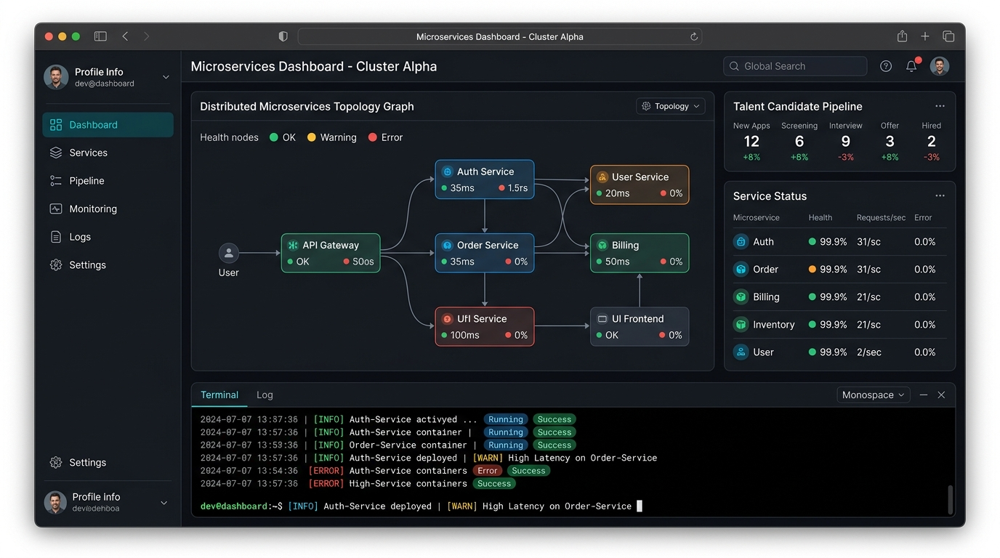

# Vasudev — Systems & Software Portfolio

A personal developer portfolio built with an **editorial systems aesthetic**, faithfully implementing the approved Google Stitch design. The portfolio combines Swiss typographic precision, warm parchment tones, restrained terracotta accents, and engineering clarity.



---

## 🛠 Technology Stack

- **Framework**: [React 19](https://react.dev/) + [Vite](https://vitejs.dev/)
- **Language**: [TypeScript](https://www.typescriptlang.org/)
- **Styling**: Plain Vanilla CSS with CSS Custom Properties (Design Tokens)
- **Linter**: [Oxlint](https://oxc.rs/)
- **Fonts**:
  - Primary Sans: `Plus Jakarta Sans`
  - Editorial Accent (Italics): `Newsreader`
  - Technical Monospace: `JetBrains Mono`

---

## 🚀 Quick Start

### 1. Prerequisites
Ensure you have [Node.js](https://nodejs.org/) (v18 or higher) installed on your system.

### 2. Install Dependencies
```bash
npm install
```

### 3. Run Development Server
```bash
npm run dev
```
Open [http://localhost:5173](http://localhost:5173) in your browser to view the application with Hot Module Replacement (HMR).

### 4. Build for Production
```bash
npm run build
```
Generates a static production bundle in the `dist/` directory.

### 5. Run Linter & Typechecks
```bash
npm run lint
```

---

## 📁 Project Structure

```
vasudev-portfolio/
├── public/                 # Static public assets (favicons, etc.)
├── src/
│   ├── assets/             # Images and project preview mockups
│   │   ├── portrait.jpg            # Hero portrait photograph
│   │   ├── project_recruitment.jpg # #01 Online Job Recruitment System
│   │   ├── project_ecommerce.jpg   # #02 Scalable E-commerce Platform
│   │   └── project_maternal.jpg    # #03 Maternal Healthcare Platform
│   ├── components/         # Modular, focused React components
│   │   ├── Navbar.tsx              # Brand badge, nav links, and "LET'S TALK" button
│   │   ├── Hero.tsx                # [00] Editorial hero, tags, and portrait card
│   │   ├── SelectedWork.tsx        # [01] Featured microservice architecture & grid
│   │   ├── ProjectCard.tsx         # Reusable card component for grid projects
│   │   ├── AboutPhilosophy.tsx     # [02] Blueprint grid card & engineering philosophy
│   │   ├── NotesBanner.tsx         # Technical writing banner
│   │   ├── ContactFooter.tsx       # [06] Dark section, email link, and social buttons
│   │   └── CustomCursor.tsx        # Precision dot + smooth trailing ring custom cursor
│   ├── data/
│   │   └── portfolioData.ts        # Centralized content: projects, bio, links, and tags
│   ├── hooks/
│   │   └── useScrollReveal.ts      # IntersectionObserver-based scroll animation hook
│   ├── styles/
│   │   ├── tokens.css              # Color palette, spacing, and font variables
│   │   ├── global.css              # CSS reset, accessible focus styles, utilities
│   │   ├── components.css          # Pixel-accurate component stylesheets
│   │   └── cursor.css              # Custom cursor styles & media queries
│   ├── App.tsx             # Root application assembly
│   ├── main.tsx            # React application entry point
│   └── index.css           # Global stylesheet entry
├── index.html              # HTML template with Google Fonts preconnects
├── package.json            # Project dependencies and npm scripts
├── tsconfig.json           # TypeScript configuration
└── vite.config.ts          # Vite build configuration
```

---

## 🎨 Customization & Content Updates

### 1. Replacing the Portrait Photo
To substitute the dummy portrait with your own real photograph:
1. Place your photo inside `src/assets/`.
2. Name it `portrait.jpg` (or change the import path in [`src/components/Hero.tsx`](file:///c:/Users/vgajj/Desktop/My_portfolio/src/components/Hero.tsx)).
3. Recommended aspect ratio: **4:5** (e.g. 960 × 1200 px) with natural lighting.

### 2. Updating Project Details & Social Links
All text, project descriptions, links, and tags are maintained cleanly in a single configuration file:
👉 Open [`src/data/portfolioData.ts`](file:///c:/Users/vgajj/Desktop/My_portfolio/src/data/portfolioData.ts) to edit:
- Project titles, technologies, descriptions, and bullets.
- GitHub and LinkedIn profile URLs.
- Email address (`hello@vd-engineer.dev`).
- Engineering philosophy points and "What I'm exploring next".

### 3. Updating Project Previews
Replace any image in `src/assets/` (`project_recruitment.jpg`, `project_ecommerce.jpg`, `project_maternal.jpg`) with actual screenshots of your running applications as they become available.

---

## 🖱 Interactive Features

- **Custom Dual Cursor**: Features a precise central dot and a lerp-based trailing ring that smoothly expands over interactive links, buttons, and project cards. Automatically falls back to native cursor on touch/mobile devices and respects `prefers-reduced-motion`.
- **One-Click Email Copy**: Clicking the email address in the footer automatically copies it to the clipboard and triggers a confirmation badge.
- **Accessible Motion**: Soft scroll-triggered reveals powered by `IntersectionObserver`. Fully disabled for users with `prefers-reduced-motion: reduce`.

---

## 🌐 Deployment Guide

### Deploy to Vercel
1. Push your repository to GitHub.
2. Sign in to [Vercel](https://vercel.com) and import the `vasudev-portfolio` repository.
3. Vercel automatically detects Vite:
   - **Framework Preset**: Vite
   - **Build Command**: `npm run build`
   - **Output Directory**: `dist`
4. Click **Deploy**.

### Deploy to Netlify
1. Sign in to [Netlify](https://netlify.com) and click **Add new site > Import an existing project**.
2. Select your GitHub repository.
3. Configure build settings:
   - **Build Command**: `npm run build`
   - **Publish Directory**: `dist`
4. Click **Deploy Site**.

---

## 📄 License
© 2025 Vasudev. Designed with deliberate art direction. Implemented with precision.
